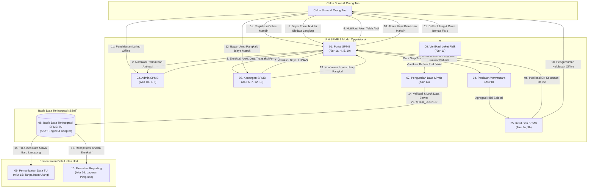

# 🏛️ Planning Blueprint: Sistem Informasi SPMB & Integrasi Tata Usaha (TU)
## SMA Muhammadiyah 3 Yogyakarta

Dokumen ini merupakan **Cetak Biru Perencanaan Terpadu (Integrated Planning Blueprint)** yang disusun berdasarkan sintesis menyeluruh dari dokumen perencanaan proyek TI:
- **Laporan 3**: Analisis Masalah Organisasi, Peta Stakeholder, dan Akar Masalah (Fishbone/Impact-Effort Matrix).
- **Laporan 4**: Perumusan Tujuan Proyek (SMART), Scope (In/Out-of-Scope), dan Deliverables.
- **Laporan 5**: Penetapan Peran Tim, RACI Matrix, dan Grand Design 16 Alur Informasi.
- **Laporan 6**: Arsitektur SI 3-Tier Berlapis, Strategi Implementasi (Hybrid/Waterfall/Agile), dan Manajemen Perubahan Resistensi.
- **Laporan 7**: Penjadwalan Kerja (Gantt Chart), Jaringan PERT, Critical Path (Jalur Kritis 18–20 Hari), dan Pembagian Beban Kerja Mingguan.

---

## 1. Filosofi Arsitektur & Fondasi Sistem

> [!IMPORTANT]
> **Prinsip Dasar Arsitektur**: Sistem dibangun secara holistik berdasarkan **Grand Design Alur 1a hingga 16**, mencakup siklus hidup lengkap pendaftaran siswa (online & offline), verifikasi keuangan 2 tahap, penilaian wawancara peminatan, seleksi kelulusan, loket daftar ulang berkas fisik, mekanisme penguncian data (Data Locking), integrasi basis data Single Source of Truth (SSoT), operasional Tata Usaha tanpa re-entry data, hingga pelaporan otomatis eksekutif.

### 1.1 Masalah Organisasi yang Diselesaikan
1. **Masalah Utama (M2) — Eliminasi Duplikasi Data SPMB ke TU**:
   - Menghilangkan pencatatan ulang manual ratusan biodata siswa oleh petugas TU setelah proses SPMB selesai.
   - Menjawab kekhawatiran keamanan dan potensi kebocoran data dengan menyediakan **gerbang validasi & penguncian data (Data Locking)** sebelum dilepas ke TU.
2. **Masalah Sekunder (M1) — Efisiensi Pelaporan Eksekutif**:
   - Memangkas durasi pelaporan rekapitulasi penerimaan siswa ke Kepala Sekolah dan Majelis Dikdasmen/Yayasan dari hitungan hari menjadi dasbor analitik instan (*real-time*).
3. **Optimasi Pelayanan Pendaftar**:
   - Mendukung pendaftaran mandiri *self-service* 24 jam serta loket bantuan bagi pendaftar luring (offline) tanpa diskriminasi alur data.

### 1.2 Target Proyek (Kriteria SMART)
- **Specific**: Menyediakan 10 modul sistem web modular terintegrasi via *Single Source of Truth (SSoT)*.
- **Measurable**: Minimal **90% data peserta didik baru** yang divalidasi SPMB langsung dimanfaatkan TU untuk pembagian kelas, pemetaan minat/bakat, dan kontak darurat tanpa input ulang.
- **Achievable**: Diimplementasikan dalam prototipe web modular fungsional menggunakan data simulasi (*dummy*).
- **Relevant**: Menyelesaikan silo data antar-unit, mengunci integritas data, dan mengotomasi laporan pimpinan.
- **Time-Bound**: Total durasi minimum penyelesaian adalah **18–20 Hari Kerja Efektif** (4 minggu pengerjaan).

---

## 2. Grand Design Alur Informasi (16 Alur) & Arsitektur 3-Tier



---

## 3. Rincian Kebutuhan Modul 01 – 10 Sesuai Alur Grand Design

Berikut merupakan spesifikasi kebutuhan fungsional dan teknis dari masing-masing modul berdasarkan diagram Grand Design:

### 1. Modul 01: Portal SPMB (`01_portal_spmb`)
- **Entitas Diagram**: Calon Siswa & Orang Tua dan Sistem Portal SPMB.
- **Nomor Alur Terkait**:
  - **Alur 1a**: Registrasi akun secara online.
  - **Alur 4**: Menerima notifikasi akun aktif.
  - **Alur 5**: Pembayaran biaya pendaftaran dan pengisian biodata lengkap.
  - **Alur 10**: Akses pengumuman kelulusan mandiri.
- **Kebutuhan Fitur**:
  - Halaman registrasi & login mandiri siswa.
  - Formulir biodata lengkap (data diri, asal sekolah, NISN, pilihan peminatan MIPA/IPS, data orang tua).
  - Upload berkas digital (kartu keluarga, pas foto, bukti transfer biaya pendaftaran).
  - Dasbor pelacak status pendaftaran (Menunggu Aktivasi → Aktif → Wawancara → Pengumuman Kelulusan).
- **Tujuan & Pemecahan Masalah**: Menyediakan antarmuka pendaftaran *self-service* 24 jam sehingga pendaftar tidak perlu mengantre secara fisik di sekolah.
- **Strategi & Layer**: **Agile** | *Presentation Layer*.

---

### 2. Modul 02: Admin SPMB (`02_admin_spmb`)
- **Entitas Diagram**: Transisi antara Sistem Portal SPMB dan Unit SPMB / Tim Pengelola SPMB.
- **Nomor Alur Terkait**:
  - **Alur 2**: Menerima notifikasi permintaan aktivasi akun dari pendaftar online.
  - **Alur 3**: Eksekusi aktivasi akun pendaftar lewat portal.
  - **Alur 1b**: Pelayanan dan pencatatan pendaftaran langsung bagi pendaftar luring (offline).
- **Kebutuhan Fitur**:
  - Dasbor pemantauan antrean akun pendaftar baru.
  - Verifikasi kevalidan identitas dasar (NISN dan dokumen pendukung).
  - Tombol aktivasi akun pendaftar dengan aksi satu klik.
  - Formulir registrasi loket khusus pendaftar luring yang datang langsung ke sekolah.
- **Tujuan & Pemecahan Masalah**: Menjamin identitas pendaftar valid dan bebas duplikasi sebelum diproses ke tahapan seleksi berikutnya.
- **Strategi & Layer**: **Waterfall** | *Application / Business Logic Layer*.

---

### 3. Modul 03: Keuangan SPMB (`03_keuangan_spmb`)
- **Entitas Diagram**: Bendahara SPMB / Bagian Keuangan.
- **Nomor Alur Terkait**:
  - **Alur 6**: Penerimaan info/data pembayaran pendaftaran via portal.
  - **Alur 7**: Konfirmasi dan verifikasi status pembayaran pendaftaran ke portal.
  - **Alur 12**: Penerimaan pembayaran uang pangkal / biaya daftar ulang.
  - **Alur 13**: Konfirmasi pembayaran uang pangkal ke portal.
- **Kebutuhan Fitur**:
  - Monitoring antrean transaksi pembayaran tahap 1 (formulir) dan tahap 2 (uang pangkal).
  - Modal pratinjau bukti transfer/struk pembayaran.
  - Tombol persetujuan (approval) status bayar menjadi `LUNAS`.
  - Pencatatan pos keuangan daftar ulang dan cetak kuitansi digital.
- **Tujuan & Pemecahan Masalah**: Mengintegrasikan verifikasi finansial dua tahap ke dalam SSoT secara *real-time* tanpa risiko nota fisik tercecer atau salah rekap.
- **Strategi & Layer**: **Waterfall** | *Application / Business Logic Layer*.

---

### 4. Modul 04: Penilaian Wawancara & Pemetaan Jurusan (`04_wawancara_spmb`)
- **Entitas Diagram**: Tim Wawancara (Guru & Tenaga Kependidikan).
- **Nomor Alur Terkait**:
  - **Alur 8**: Penilaian hasil wawancara diinputkan ke sistem portal setelah tes selesai.
- **Kebutuhan Fitur**:
  - Filter peserta yang telah berstatus `LUNAS` biaya pendaftaran (Alur 7).
  - Formulir input skor penilaian siswa dan wawancara orang tua/wali.
  - Pemetaan bakat, minat ekstrakurikuler, dan komitmen belajar.
  - Kalkulasi otomatis beasiswa Tahfidz Al-Qur'an (≥15 Juz = Beasiswa Penuh, 1–14 Juz = Beasiswa Parsial).
  - Rekomendasi kelaikan jurusan (MIPA atau IPS).
- **Tujuan & Pemecahan Masalah**: Mencatat evaluasi kualitatif dan pemetaan peminatan langsung oleh guru penguji tanpa lembar penilaian kertas yang rentan hilang.
- **Strategi & Layer**: **Waterfall** | *Application / Business Logic Layer*.

---

### 5. Modul 05: Kelulusan SPMB (`05_kelulusan_spmb`)
- **Entitas Diagram**: Unit SPMB, Sistem Portal SPMB, dan Calon Siswa.
- **Nomor Alur Terkait**:
  - **Alur 9a**: Seleksi calon siswa dan publikasi SK kelulusan ke portal.
  - **Alur 9b**: Pengumuman kelulusan langsung bagi pendaftar luring.
- **Kebutuhan Fitur**:
  - Perankingan otomatis berdasarkan agregasi nilai rapor dan skor wawancara Modul 04.
  - Manajemen kuota jurusan (MIPA: 140, IPS: 105).
  - Penetapan status: `LULUS`, `CADANGAN`, atau `TIDAK LULUS`.
  - Penerbitan Surat Keputusan (SK) Kelulusan dan tombol publikasi massal ke portal (Alur 10).
- **Tujuan & Pemecahan Masalah**: Mempercepat rapat yudisium penentuan kelulusan secara transparan, objektif, dan otomatis.
- **Strategi & Layer**: **Waterfall** | *Application / Business Logic Layer*.

---

### 6. Modul 06: Verifikasi Berkas Fisik / Loket Daftar Ulang (`06_verifikasi_loket`)
- **Entitas Diagram**: Interaksi fisik tatap muka di Unit SPMB / Loket Sekolah.
- **Nomor Alur Terkait**:
  - **Alur 11**: Daftar ulang calon siswa & orang tua secara tatap muka ke Unit SPMB.
- **Kebutuhan Fitur**:
  - Pencarian cepat data pendaftar yang telah dinyatakan `LULUS` seleksi.
  - Lembar checklist verifikasi fisik dokumen asli (ijazah legalisir, akta kelahiran, kartu keluarga, surat bebas narkoba).
  - Pencatatan pengambilan seragam dan perlengkapan sekolah.
  - Pemutakhiran status daftar ulang menjadi `VERIFIKASI_LOKET_SELESAI`.
- **Tujuan & Pemecahan Masalah**: Menjamin keabsahan berkas fisik asli sebelum calon peserta didik resmi dikonfirmasi sebagai murid baru.
- **Strategi & Layer**: **Hybrid** | *Presentation & Application Layer*.

---

### 7. Modul 07: Pengelolaan & Penguncian Data SPMB (`07_pengelolaan_data`)
- **Entitas Diagram**: Panah keluaran Unit SPMB menuju basis data terintegrasi.
- **Nomor Alur Terkait**:
  - **Alur 14**: Validasi & Lock Data Siswa ke Basis Data.
- **Kebutuhan Fitur**:
  - Audit pra-kunci (verifikasi kelengkapan: status lulus seleksi, lunas uang pangkal Alur 13, dan berkas fisik terverifikasi Alur 11).
  - Tombol pembekuan data (*Data Locking Engine*) mengubah status menjadi `VERIFIED_LOCKED` (`is_locked: true`).
  - Pencegahan pengeditan data sepihak setelah status dikunci.
- **Tujuan & Pemecahan Masalah (Solusi Masalah M2 - Resistensi & Integritas)**: Menjawab ketakutan panitia SPMB terhadap perubahan data sepihak dengan membuat gerbang otorisasi penguncian sebelum data dialirkan ke unit lain.
- **Strategi & Layer**: **Waterfall** | *Application / Business Logic Layer*.

---

### 8. Modul 08: Basis Data Terintegrasi / SSoT Adapter (`08_basis_data_tu`)
- **Entitas Diagram**: Basis Data Terintegrasi SPMB–TU (Single Source of Truth).
- **Nomor Alur Terkait**: Jembatan data antara Alur 14 (penyimpanan data terkunci) dan Alur 15 (penarikan data TU).
- **Kebutuhan Fitur**:
  - Penyimpanan data terpusat (`config/database.js` dengan kunci `m3_spmb_tu_db`).
  - Skema data terstruktur dan tervalidasi.
  - Mekanisme kontrol akses berbasis peran (Role-Based Access) yang aman.
- **Tujuan & Pemecahan Masalah (Solusi Masalah M2 - Eliminasi Silo Data)**: Menghilangkan sistem database terpisah antara kepanitiaan SPMB dan operasional harian Tata Usaha sekolah.
- **Strategi & Layer**: **Hybrid** | *Data Layer*.

---

### 9. Modul 09: Pemanfaatan Data Tata Usaha / TU (`09_pemanfaatan_tu`)
- **Entitas Diagram**: Bagian Administrasi / Tata Usaha (TU).
- **Nomor Alur Terkait**:
  - **Alur 15**: TU mengakses data siswa baru secara langsung tanpa input ulang.
- **Kebutuhan Fitur**:
  - Dasbor penarikan data siswa yang berstatus `VERIFIED_LOCKED`.
  - Fitur penempatan rombongan belajar / pembagian kelas (X-MIPA-1, X-MIPA-2, X-IPS-1, dll.) berbasis pemetaan minat di Modul 04.
  - Pencatatan dan validasi kontak darurat siswa (*emergency contact*).
  - Generator Buku Induk Siswa otomatis dan fitur ekspor ke format Dapodik/Excel.
- **Tujuan & Pemecahan Masalah (Solusi Utama M2 - Zero Re-entry Data)**: Memenuhi target keterterimaan proyek agar minimal 90% data siswa baru langsung dimanfaatkan TU tanpa mengetik ulang manual.
- **Strategi & Layer**: **Agile** | *Presentation & Application Layer*.

---

### 10. Modul 10: Executive Reporting / Laporan Pimpinan (`10_executive_report`)
- **Entitas Diagram**: Majelis Dikdasmen / Yayasan & Kepala Sekolah.
- **Nomor Alur Terkait**:
  - **Alur 16**: Akses laporan akhir via sistem laporan akhir SPMB.
- **Kebutuhan Fitur**:
  - Dasbor analitik metrik eksekutif *real-time*.
  - Visualisasi persentase keterisian kuota per jurusan (MIPA & IPS).
  - Analisis demografi asal sekolah pendaftar.
  - Rasio konversi pendaftar hingga lunas daftar ulang.
  - Ringkasan total penerimaan finansial (formulir dan uang pangkal).
  - Fitur cetak/ekspor dokumen laporan akhir resmi (PDF/Print Ready).
- **Tujuan & Pemecahan Masalah (Solusi Utama M1 - Akselerasi Laporan Pimpinan)**: Memangkas durasi penyusunan laporan untuk yayasan dan kepala sekolah dari hitungan hari menjadi laporan instan berbasis data terpadu.
- **Strategi & Layer**: **Waterfall** | *Presentation Layer*.

---

## 4. Matriks Peran & Tata Kelola Tim (RACI Framework)

Setiap modul memiliki **Single Accountable (A)** untuk menjamin akuntabilitas hasil kerja:

| Modul / Aktivitas | Project Lead (Raudhatul) | Analis Sistem (Yosa) | Desainer & Dok. (Novelia) | Tanggung Jawab Utama |
| :--- | :---: | :---: | :---: | :--- |
| **01. Portal SPMB** | C | **A, R** | R | Yosa mengontrol alur proses; Novelia merancang UI responsif. |
| **02. Admin SPMB** | R | **A, R** | C | Yosa memvalidasi aturan aktivasi akun pada Jalur Kritis. |
| **03. Keuangan SPMB** | C | **A, R** | R | Yosa memimpin aturan verifikasi; Novelia merancang antarmuka kasir. |
| **04. Penilaian Wawancara** | R | **A, R** | C | Yosa menentukan formula skoring pemetaan jurusan MIPA/IPS. |
| **05. Kelulusan SPMB** | R | **A, R** | C | Yosa menetapkan passing grade dan status publikasi kelulusan. |
| **06. Verifikasi Loket** | C | **A, R** | R | Yosa mengelola alur loket; Novelia memastikan UX verifikasi fisik intuitif. |
| **07. Pengelolaan Data SPMB** | C | **A, R** | R | Yosa memimpin fungsi *Data Locking* sebelum data diteruskan ke TU. |
| **08. Basis Data Terpadu TU** | **A, R** | C | C | **Raudhatul** memimpin arsitektur SSoT & keamanan akses data. |
| **09. Pemanfaatan Data TU** | **A, R** | C | R | **Raudhatul** memastikan TU dapat mengambil data tanpa input ulang. |
| **10. Executive Reporting** | C | R | **A, R** | **Novelia** memimpin pembuatan dasbor rekapitulasi & panduan pengguna. |

---

## 5. Timeline Proyek, Analisis PERT & Jalur Kritis (20 Hari Kerja)

```mermaid
gantt
    title Jadwal Implementasi 10 Modul M3 SPMB-TU (20 Hari Kerja Efektif)
    dateFormat  X
    axisFormat Hari %s

    section Jalur Kritis (Critical Path)
    01. Portal SPMB (M1 - 3 Hari)          :crit, m1, 0, 3d
    02. Admin SPMB (M2 - 2 Hari)           :crit, m2, after m1, 2d
    04. Penilaian Wawancara (M4 - 2 Hari)  :crit, m4, after m2, 2d
    05. Kelulusan SPMB (M5 - 2 Hari)       :crit, m5, after m4, 2d
    06. Verifikasi Loket (M6 - 3 Hari)     :crit, m6, after m5, 3d
    07. Penguncian Data (M7 - 2 Hari)      :crit, m7, after m6, 2d
    08. Basis Data Terpadu (M8 - 4 Hari)   :crit, m8, after m7, 4d
    09. Pemanfaatan Data TU (M9 - 2 Hari)  :crit, m9, after m8, 2d

    section Jalur Paralel / Slack
    03. Keuangan SPMB (M3 - 2 Hari)        :active, m3, after m1, 2d
    10. Executive Report & Docs (M10)      :m10, after m8, 2d
```



---

## 6. Struktur Skema Data Terpadu (`config/database.js`)

Struktur objek data dalam SSoT yang mengikat ke-16 alur data di atas:

```javascript
{
  id: "REG-2026-001",
  nama: "Ahmad Dahlan",
  nisn: "0051234567",
  asal_sekolah: "SMP Muhammadiyah 1 Yogyakarta",
  pilihan_jurusan: "MIPA",
  
  // Status Alur 1a - 4 (Modul 01 & 02)
  status_akun: "AKTIF",              
  
  // Status Alur 6 - 7 (Modul 03)
  status_pembayaran_formulir: "LUNAS",
  
  // Data Alur 8 (Modul 04)
  wawancara: {
    skor_siswa: 90,
    skor_wali: 86,
    nilai_akhir: 88,
    hafalan_juz: 3,
    beasiswa: "Potongan SPP (Beasiswa Tahfidz Parsial)",
    rekomendasi_jurusan: "MIPA"
  },
  
  // Status Alur 9a - 10 (Modul 05)
  status_kelulusan: "LULUS",         
  
  // Status Alur 11 - 13 (Modul 03 & 06)
  status_pembayaran_uang_pangkal: "LUNAS",
  verifikasi_dokumen_fisik: {
    ijazah: true,
    kartu_keluarga: true,
    akta_lahir: true,
    surat_bebas_narkoba: true,
    status: "LENGKAP"
  },
  status_daftar_ulang: "VERIFIKASI_LOKET_SELESAI",
  
  // Status Kunci Alur 14 (Modul 07)
  is_locked: true,                   // VERIFIED_LOCKED
  locked_at: "2026-10-10T11:00:00Z",
  locked_by: "Panitia SPMB",
  
  // Data Pemanfaatan Alur 15 (Modul 09 - Tanpa Input Ulang)
  data_tu: {
    kelas_terpilih: "X-MIPA-1",
    peminatan_ekskul: ["Hizbul Wathan", "Robotik"],
    kontak_darurat: {
      nama_kontak: "K.H. Dahlan (Ayah)",
      nomor_telepon: "081234567890",
      hubungan: "Orang Tua Kandung"
    },
    buku_induk_nomor: "M3-2026-0001",
    status_dapodik: "SIAP_SINKRON"
  }
}
```
