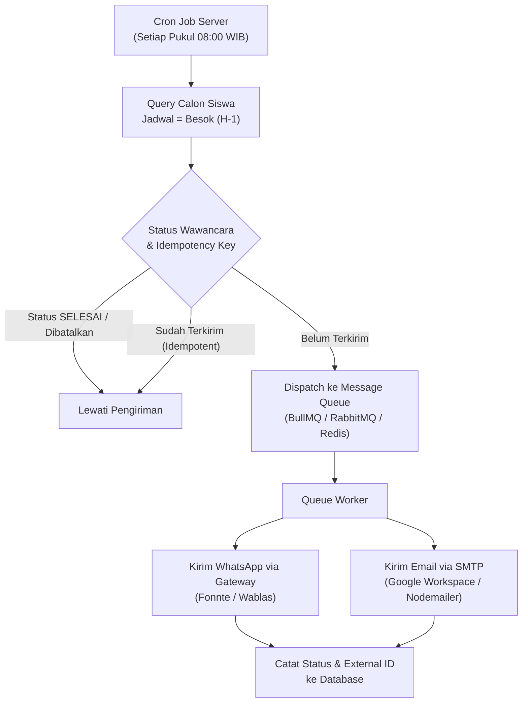

# SPESIFIKASI ARSITEKTUR BACKEND SCHEDULER & GATEWAY PENGINGAT H-1
## SPMB SMA Muhammadiyah 3 Yogyakarta — Modul 04 Wawancara

Dokumen ini merupakan panduan teknis implementasi backend scheduler, worker, dan integrasi messaging gateway untuk pengiriman otomatis pengingat jadwal wawancara H-1.

---

### 1. Status Arsitektur Saat Ini

| Komponen | Status Saat Ini | Kebutuhan Implementasi |
|---|---|---|
| **Frontend UI (Modul 04)** | **Selesai (Siap Terintegrasi)** | Antarmuka monitoring, preview template, dan filter status pengingat |
| **Service Adapter Client** | **Selesai (reminderService.js)** | Menyediakan payload baku, idempotency key, dan HTTP client |
| **Backend API Gateway** | **Belum Terintegrasi (Perlu Dikonfigurasi)** | REST API server (Node.js Express / Laravel / FastAPI) |
| **Cron Job / Scheduler** | **Belum Tersedia di Server** | Daemon scheduler yang berjalan 24/7 di server |
| **WhatsApp Gateway** | **Belum Dihubungkan** | Akun provider Fonnte / Wablas / Twilio / Meta Cloud API |
| **Email SMTP Gateway** | **Belum Dihubungkan** | SMTP Server SMA Muhammadiyah 3 Yogyakarta / SendGrid |

> ⚠️ **Catatan Penting Keamanan & Kejujuran Sistem:**
> Aplikasi frontend **tidak menanamkan API Key rahasia** di sisi browser dan **tidak menyimulasikan keberhasilan pengiriman pesan** apabila belum ada respons sukses dari server gateway. Seluruh status pengingat ditandai secara transparan sebagai *Menunggu Pengiriman* atau *Belum Terintegrasi ke Backend Gateway*.

---

### 2. Alur Kerja Scheduler H-1 (Server-Side Architecture)

Pengiriman otomatis pengingat **wajib** dieksekusi di sisi server menggunakan background daemon (bukan `setTimeout`/`setInterval` di browser):



---

### 3. Kontrak REST API (Frontend &lt;-&gt; Backend)

#### Endpoint 1: Dispatch Pengingat Satuan / Pengujian
- **URL**: `POST /api/reminders/dispatch`
- **Headers**:
  ```http
  Content-Type: application/json
  X-Idempotency-Key: REM-REG-2026-001-20261019
  Authorization: Bearer <SERVER_SECRET_TOKEN>
  ```
- **Request Body**:
  ```json
  {
    "idempotency_key": "REM-REG-2026-001-20261019",
    "candidate": {
      "id": "REG-2026-001",
      "nama": "Ahmad Dahlan",
      "telepon_wa": "081234567890",
      "email": "ahmaddahlan@example.com"
    },
    "jadwal": {
      "tanggal": "2026-10-19",
      "jam": "08:00",
      "metode": "Luring",
      "ruang": "Ruang Wawancara 1",
      "pewawancara": "Yosa"
    },
    "reminder": {
      "scheduled_for_date": "2026-10-18",
      "scheduled_for_time": "2026-10-18T08:00:00+07:00",
      "media": ["WHATSAPP", "EMAIL"]
    },
    "messages": {
      "whatsapp_text": "*PENGINGAT JADWAL WAWANCARA SPMB...*",
      "email_subject": "[PENGINGAT H-1] Jadwal Wawancara SPMB...",
      "email_html": "<html>...</html>"
    }
  }
  ```
- **Response Sukses (HTTP 200 OK)**:
  ```json
  {
    "success": true,
    "status": "Berhasil Dikirim",
    "idempotency_key": "REM-REG-2026-001-20261019",
    "message_id": "MSG-WA-98231415",
    "dispatched_at": "2026-10-18T08:00:05+07:00"
  }
  ```
- **Response Gagal (HTTP 4xx/5xx)**:
  ```json
  {
    "success": false,
    "status": "Gagal Dikirim",
    "error": "Nomor WhatsApp tujuan tidak terdaftar atau gateway sedang maintenance.",
    "retry_allowed": true
  }
  ```

---

### 4. Contoh Implementasi Node.js Cron Scheduler (Production Ready)

```javascript
// server/cron-reminder.js
const cron = require('node-cron');
const { getCandidatesForTomorrow, markReminderSuccess, markReminderFailed } = require('./db');
const { sendWhatsAppFonnte } = require('./services/whatsapp');
const { sendEmailSMTP } = require('./services/email');

// Jalankan setiap hari pukul 08:00 WIB (Asia/Jakarta)
cron.schedule('0 8 * * *', async () => {
  console.log('[CRON] Memulai pemindaian pengingat H-1 jadwal wawancara...');
  
  const tomorrowCandidates = await getCandidatesForTomorrow();
  
  for (const c of tomorrowCandidates) {
    // 1. Cek pembatalan & pengiriman ganda (idempotency)
    if (c.statusWawancara === 'SELESAI' || c.pengingat_wawancara?.status === 'Berhasil Dikirim') {
      continue;
    }

    try {
      // 2. Kirim WhatsApp
      const waRes = await sendWhatsAppFonnte(c.telepon, c.templateWhatsApp);
      
      // 3. Kirim Email
      const mailRes = await sendEmailSMTP(c.email, c.templateEmailSubject, c.templateEmailHtml);

      // 4. Catat keberhasilan ke database
      await markReminderSuccess(c.id, {
        message_id: waRes.id,
        waktu_aktual_kirim: new Date().toISOString()
      });
    } catch (err) {
      console.error(`[CRON ERROR] Gagal mengirim ke ${c.id}:`, err.message);
      await markReminderFailed(c.id, err.message);
    }
  }
}, {
  timezone: "Asia/Jakarta"
});
```

---

### 5. Langkah Konfigurasi Lanjutan oleh Tim IT Sekolah

1. **Setup Server Backend**: Siapkan runtime Node.js/PHP/Python pada server sekolah atau VPS.
2. **Setup Provider WhatsApp**: Daftarkan nomor resmi sekolah pada penyedia gateway WhatsApp (misal Fonnte/Wablas) dan simpan API Key di file environment (`.env`) server.
3. **Setup Kredensial SMTP**: Gunakan akun email resmi Google Workspace SMA Muhammadiyah 3 (`spmb@smamuh3jogja.sch.id`).
4. **Hubungkan Environment**: Setel `window.__REMINDER_API_URL__ = 'https://api-spmb.smamuh3jogja.sch.id'` pada file HTML/konfigurasi utama sistem.

